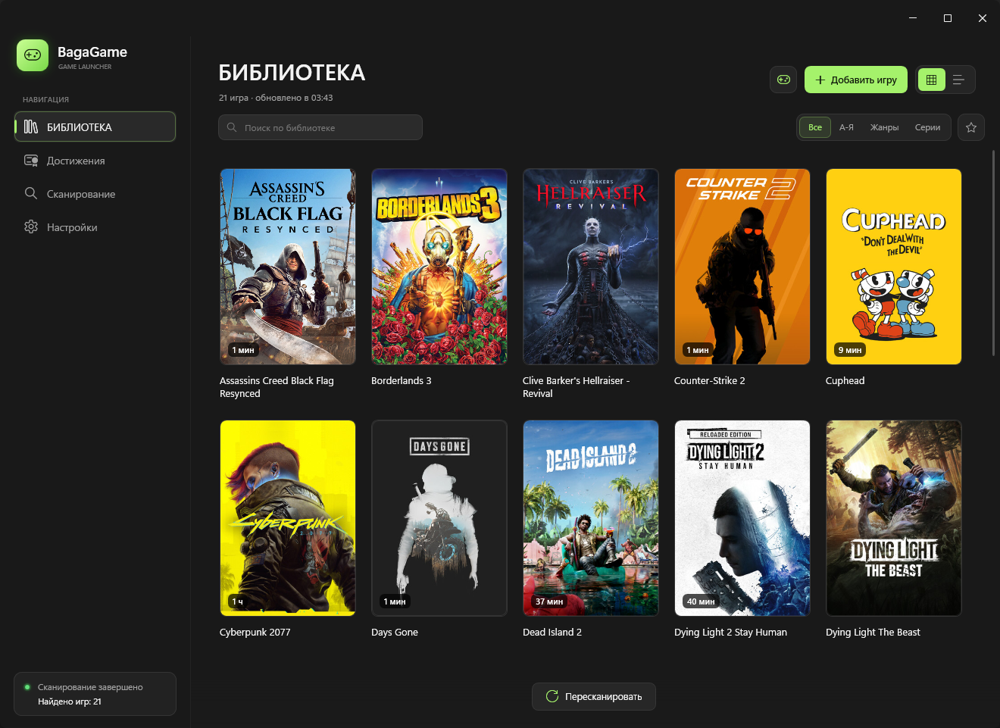
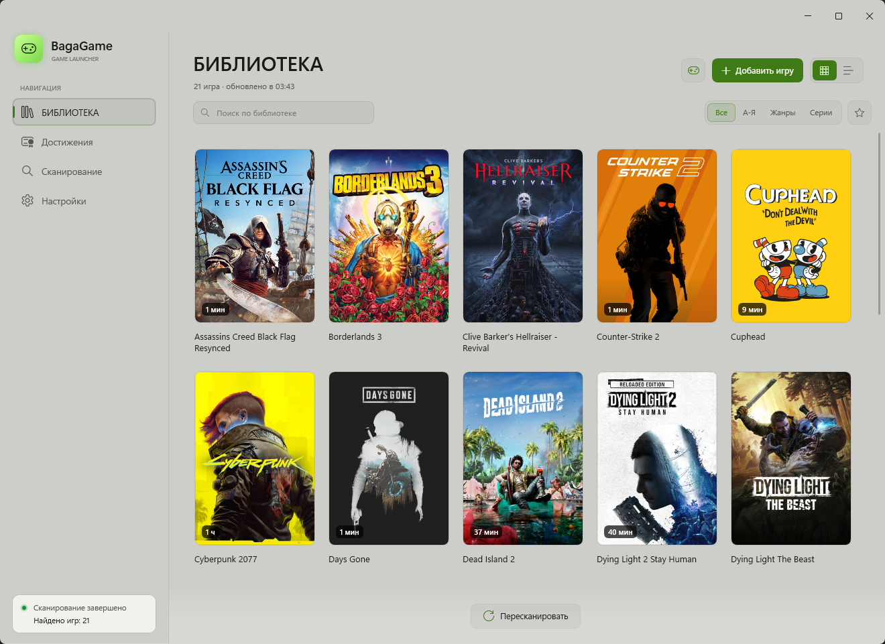
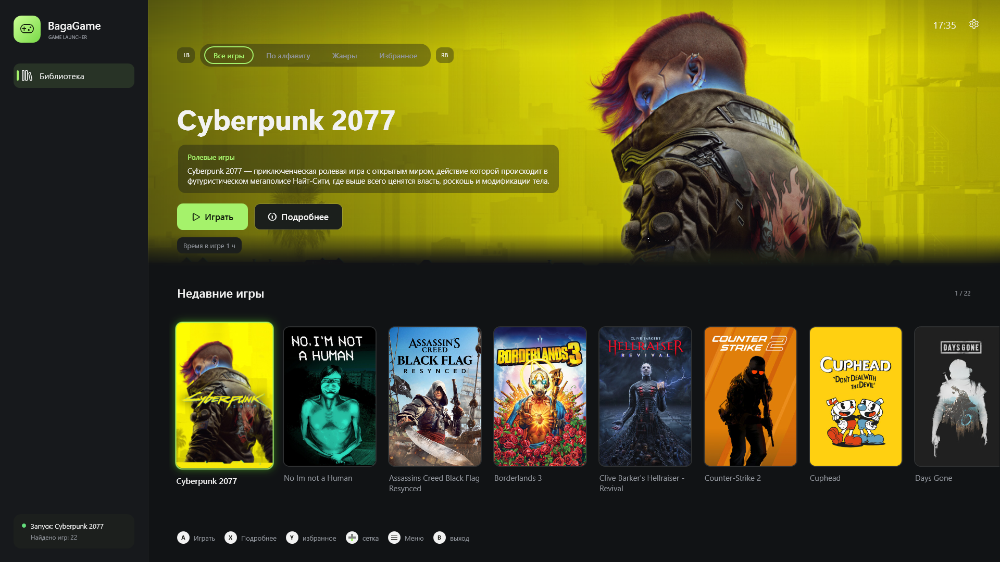
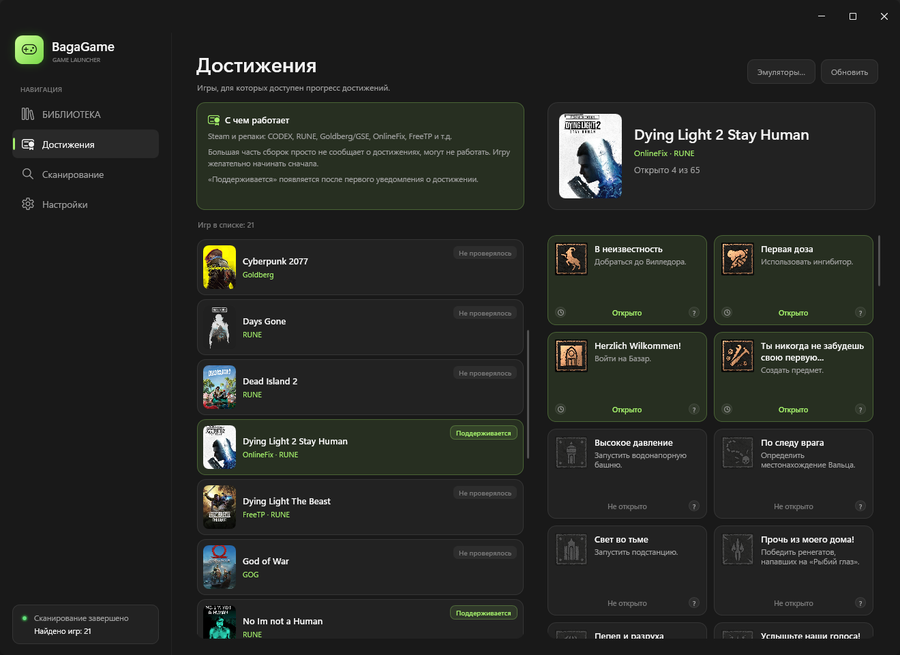
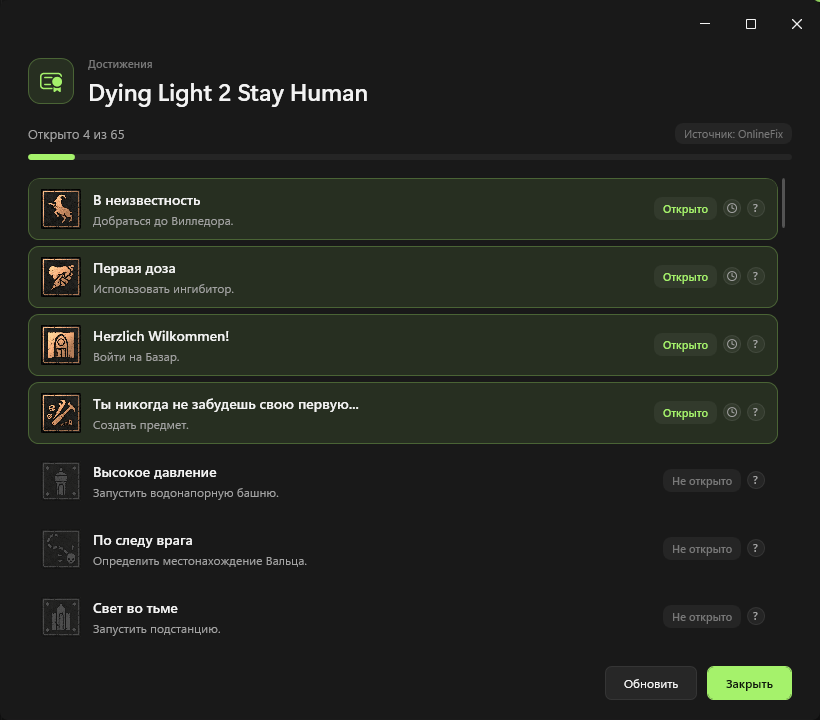
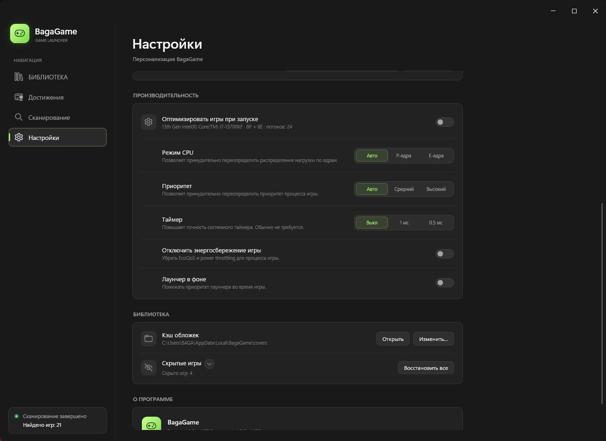
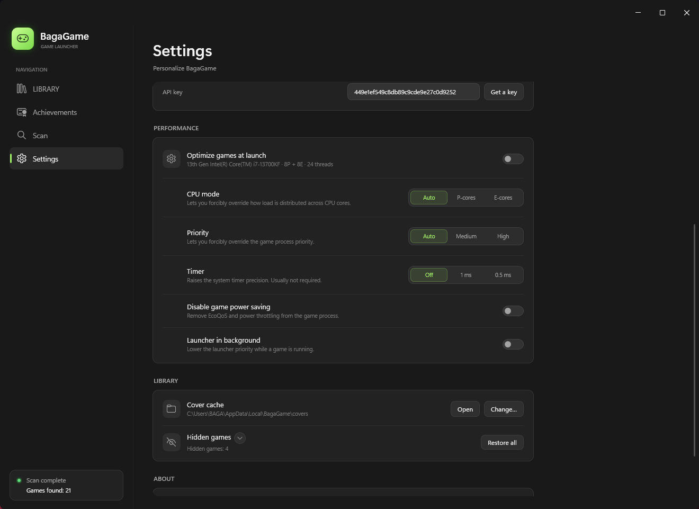
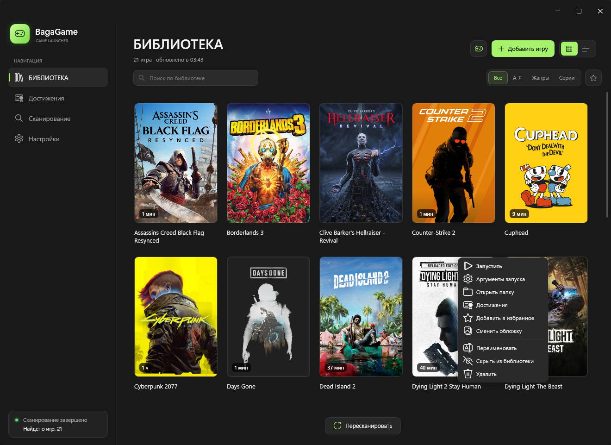
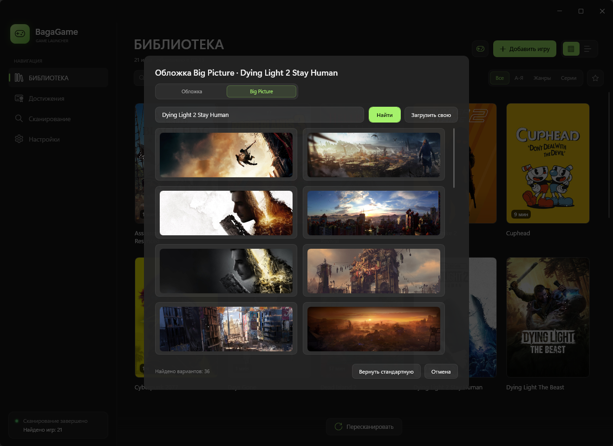
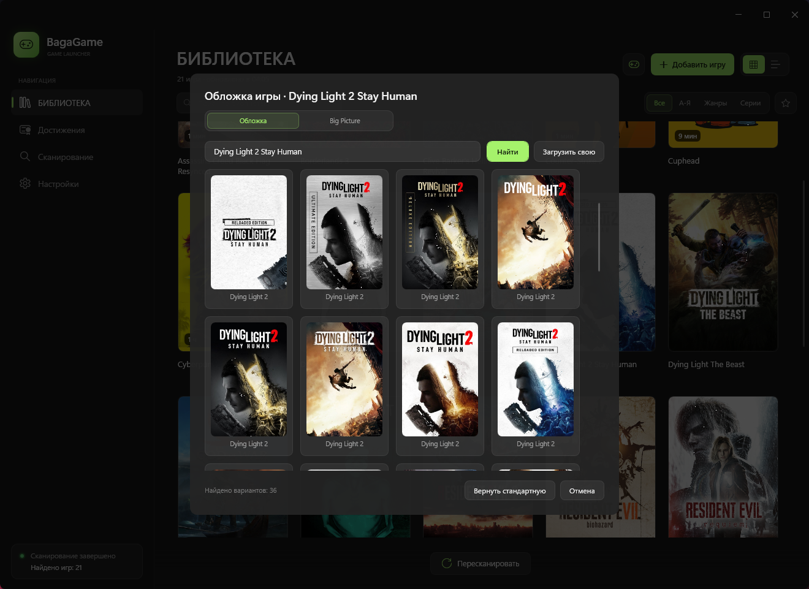

# 🎮 BagaGame Launcher

[Русский](README.ru.md) · **English**

**BagaGame Launcher** is a lightweight, fast game library organizer built in the Windows 11 Fluent style. It gathers installed games into one clean collection with posters, series and genre grouping, live search and playtime tracking — plus a full-screen **Big Picture** mode for the TV and a gamepad — instead of dozens of desktop shortcuts.

The launcher is written in **C# / WPF** on **.NET Framework 4.7.2** and uses no third-party UI framework: every control is styled by hand. That .NET version ships with Windows 10 and 11, so there is no runtime to install, and the whole app is about **1 MB**.

---

## 📥 Installation

1. Open the **[Releases](https://github.com/bagabeer/BagaGame-Launcher/releases)** page and download the latest archive (`v1.1.0`).
2. Extract it to any writable folder (for example, `D:\BagaGame`).
3. Run **`BagaGame.exe`**.

There is no installer — the app works right after unpacking. The build is a **single portable `BagaGame.exe`**: all managed dependencies are embedded, so no DLLs need to sit next to it. If a `BagaGameData` folder already exists next to the `.exe`, the launcher uses it (portable mode). For a lone `.exe` on the Desktop or in `Program Files`, data goes to `%LOCALAPPDATA%\BagaGame` instead, so no folder appears next to the executable. Create `BagaGameData` next to the exe if you want fully portable data.

> **Requirements:** Windows 10 version 1803+ or Windows 11. .NET Framework 4.7.2 is already included in the OS — nothing else needs to be installed.
>
> If Windows SmartScreen warns about an unknown publisher, click **"More info" → "Run anyway"**: the executable is not code-signed.

---

## 📸 Screenshots

| Library — dark theme | Library — light theme |
|---|---|
|  |  |

| Big Picture (RU) | Big Picture (EN) |
|---|---|
|  |  |

| Achievements | Achievement window |
|---|---|
|  |  |

| Performance settings (RU) | Performance settings (EN) |
|---|---|
|  |  |

| Context menu | Big Picture banners |
|---|---|
|  |  |

| SteamGridDB covers |
|---|
|  |

---

## ✨ Features

* **Big Picture.** A full-screen TV mode with gamepad and keyboard support: large covers, hero artwork, a carousel and a compact grid, section pills (All games / By alphabet / Genres / Favorites), genre filters, favorites and a details panel. It opens on the library monitor, hides the cursor on pad input and launches games on the same display.
* **Gamepad and keyboard.** D-pad, stick, Q/E and LB/RB switch sections; A plays, X opens details, Y toggles a favorite and B exits. A controller can open Big Picture automatically.
* **Favorites.** Star games in the library or from Big Picture and filter the collection to them.
* **Achievements.** A dedicated tab with Steam and local emulator progress (CODEX, RUNE, Goldberg, GSE, OnlineFix, FreeTP), localized names, icons, rarity and toasts. Recent achievements of the selected game appear in Big Picture.
* **Plugins.** External tabs: drop a DLL into `%LOCALAPPDATA%\BagaGame\Plugins` and restart the launcher. Developer guide: [docs/plugins.md](docs/plugins.md).
* **Performance.** Launch settings: CPU modes (Auto, P-cores, E-cores, single CCD), process priority, EcoQoS removal, launcher background and a 1 ms or 0.5 ms timer.
* **Updates.** The launcher checks for new releases, shows a dismissible card in the sidebar and can be turned off in Settings.
* **Deep scanning.** Finds games in the selected folders, including non-standard layouts and nested directories, while filtering out service executables (`unins`, `vcredist`, `crashhandler` and similar).
* **Store integration.** Imports libraries from **Steam**, **Epic Games** and **GOG Galaxy**.
* **Covers and genres.** Downloads posters and genres from the web, caches them locally and keeps working offline.
* **Grouping.** "All", "A–Z", "Genres" and "Series" modes: franchises (*Resident Evil*, *Dying Light*, *Silent Hill*…) are grouped automatically.
* **Playtime tracking.** Counts hours for games launched through the launcher and shows them right on the card.
* **Tray mode.** When a game starts, the window hides to the system tray and **automatically comes back** once the game exits.
* **Russian and English UI.** Switches in Settings without a restart and remembers the choice.
* **Dark and light themes.** Native Mica on Windows 11; a clean opaque background on Windows 10.
* **Grid and list views.** Two library layouts, live search (`Ctrl+F`) and rescan (`F5`).
* **Manual additions.** Add a whole game folder or a specific `.exe`, then rename, hide or delete games from the context menu.
* **Custom covers.** Right-click a card to upload your own image and crop it in a fixed 2:3 frame with drag and zoom. Every cover is stored as a 600×900 poster; with SteamGridDB enabled you can also browse community artwork.
* **SteamGridDB.** Optional alternative cover source with your own free API key; enable it in Settings to search community artwork instead of the built-in Steam fallback.
* **Single instance.** Launching the `.exe` again brings the running window to the front instead of opening a second copy.
* **Reliable saving.** The library is written atomically with a backup, and if a drive disappears the card stays with a "Path unavailable" badge and a "Choose folder again" action.

---

## 🗂 Application data

```text
<folder with BagaGame.exe>\BagaGameData\library.json   — library, settings, playtime, hidden games
<folder with BagaGame.exe>\BagaGameData\covers\        — posters, heroes\, metadata-v3.json and storeids.json
<folder with BagaGame.exe>\BagaGameData\covers-custom\ — user-picked 600×900 posters
```

If the folder next to the `.exe` is not writable, or it does not exist, `%LOCALAPPDATA%\BagaGame` is used instead. The cover cache can be moved to any folder independently in Settings → **Cover cache** → **Change**.

| `library.json` key | Purpose |
|---|---|
| `Hidden` | Hidden games |
| `CustomTitles` | User-defined titles |
| `Folders` | Folders to scan |
| `ManualGames` | Manually added games |
| `Genres` | Genre cache (canonical English names are stored) |
| `Playtime` | Played time in seconds |
| `LastPlayed` | Last launch time, used for the "recent" order |
| `Favorites` | Games starred in the library and Big Picture |
| `CustomCovers` | User-picked cover files in `covers-custom` |
| `UseSteamGridDb`, `SteamGridDbApiKey` | Optional SteamGridDB source and API key |
| `Theme`, `Language`, `GridView`, `DownloadCovers`, `CacheDirectory` | Interface preferences |
| `BigPictureOnGamepad`, `BigPictureSounds` | Big Picture options |

---

## 🛠 Building from source

All you need is the **.NET SDK 8+**: it builds the project for .NET Framework 4.7.2 through reference assemblies, so Visual Studio is optional.

```powershell
dotnet build BagaGame.csproj -c Release
dotnet run --project BagaGame.csproj
```

The ready `.exe` appears in `bin\Release\net472\` and is **portable on its own**: Costura embeds every managed dependency, so the folder contains just `BagaGame.exe`. No installer or separate DLL set is required.

### Project structure

```text
BagaGame.csproj                     — net472, WPF + WinForms (tray only), no third-party UI packages
App.xaml / App.xaml.cs              — startup, single instance, language, theme
MainWindow.xaml / .xaml.cs          — window, cards, search, hotkeys, tray
Views/BigPictureWindow.xaml / .cs   — full-screen TV mode, sections, hints, details panel
ViewModels/MainViewModel.cs         — filtering, groups, statuses, covers
ViewModels/BigPictureViewModel.cs   — sections, genres, favorites and details text
Models/Game.cs                      — game model and localized labels
Services/GameLibraryService.cs      — Steam / Epic / GOG / folder scanner, covers and genres
Services/PlaytimeTracker.cs         — playtime accounting and game-exit event
Services/LibraryStore.cs            — atomic library.json persistence
Services/LibraryGrouping.cs         — "A–Z", "Genres" and "Series" groups
Services/Localization.cs            — RU/EN and string dictionaries
Services/Input/GamepadService.cs    — XInput polling and pad commands
Services/Audio/UiSounds.cs          — navigation and favorite sounds
Services/BigPictureTransition.cs    — Big Picture enter/exit animation
Services/TrayIcon.cs                — tray icon and menu
Services/AppPaths.cs                — portable data folder resolution
Themes/                             — palettes, control styles, Strings.ru/en.xaml
Controls/                           — custom Fluent controls (window, buttons, toggles)
Compat/                             — polyfills for modern C# on net472
```

---

## 📝 Changelog

### Version 1.1.0 — plugins

**Plugins**
* External tabs: drop a plugin into `%LOCALAPPDATA%\BagaGame\Plugins` and restart the launcher.
* A stable `BagaGame.PluginApi` contract in its own assembly, so plugins survive launcher updates.
* A theme-aware UI kit for plugin pages: headings, cards, text and buttons.
* Developer guide and a working sample in [docs/plugins.md](docs/plugins.md).

### Version 1.0.0

**Achievements**
* Achievements tab with supported games, platforms, progress and status.
* Russian and English Steam catalogues, icons and global rarity percentages.
* Local CODEX, RUNE, Goldberg, GSE, OnlineFix and FreeTP progress, Steam profile and platform emulators.
* New-achievement toasts, cached icons and the Supported status only after a real toast.
* A clear note for private Steam profiles, clean cards and tooltips.
* Recent achievements of the selected game in the Big Picture sidebar, up to five.
* Unlock date and time in achievement cards and Big Picture.

**Performance**
* Universal launch optimisation with detailed settings.
* CPU topology detection with Auto, P-core and E-core modes for hybrid Intel.
* Single-CCD selection for dual-CCD AMD.
* Priority, EcoQoS removal, launcher background and a 1 ms or 0.5 ms timer.
* Per-game launch arguments.

**Covers and Big Picture**
* A Cover and Big Picture switch in the cover window.
* Wide SteamGridDB banner search and custom banner upload.
* Banner cropping and saving at 1920x620.

**Game removal**
* Full removal of the game folder, saves, emulator data by AppID and local Steam data.
* Mandatory confirmation with the complete path list.

**Cleanup and interface**
* Safe automatic cleanup of temporary files, archives, old versions and logs, always enabled.
* Unified settings, compact segments and tooltips, and no extra dialog glow.

### Version 0.9.0 — Big Picture

**Big Picture — a full-screen TV mode**
* Hero artwork, large covers, sound effects and an animated entry/exit with a launch splash.
* Gamepad (XInput) and keyboard support; a connected controller can open Big Picture automatically.
* Controls: D-pad/stick navigate, **A** plays, **X** opens details, **Y** toggles a favorite, **B** exits; **Q/E** and **LB/RB** switch sections.
* Opens on the library monitor, scales for 4K and follows the light and dark theme.
* Section pills float over the hero; the carousel and the compact grid share the same selection.
* D-pad Down switches between carousel and grid, the stick walks the covers, and the selected cover lifts out of the row.
* The grid scrolls to the selected card and keeps the stick inside the visible rows.
* The mouse cursor hides on controller input and returns only when the mouse actually moves.
* Gamepad and keyboard hints use vector glyphs for the D-pad and controller buttons.

**Sections, genres and favorites**
* Sections **All games**, **By alphabet**, **Genres** and **Favorites**; switch with Q/E, LB/RB or the pills.
* Big Picture sections are independent of the library, and the mode always starts on All games. The library keeps its own Series grouping.
* Every section switch starts from the first game in the natural order — the list is not reordered around the previously selected game.
* Genre bar with game counts, arrows and filtering; the active genre is highlighted and the switch has its own sound.
* Genres of new games are loaded automatically in both Big Picture and the library.
* Favorites: press **Y** to star or unstar the selected game, with separate add/remove sounds and a fading toast. The Favorites section has its own empty state.

**Details panel**
* The full store description, played time on top and the game folder below.
* The text scrolls with the stick, arrow keys and Page Up / Page Down.
* The panel is modal: covers, sections and the grid stay put while it is open.
* Always opens at the top of the text and closes with **B**, **X**, **Space**, **Enter**, **Esc** or a click outside.
* A hidden cursor stays hidden when the panel opens.

**Library and launcher**
* Favorites in the library with a star filter and a context-menu action.
* Update checker with a dismissible sidebar card and a Settings toggle.
* Games launched from Big Picture open on the Big Picture monitor; games launched from the library open on the launcher's monitor.
* The library always opens on All games, and the grouping choice is no longer saved.
* Selected-cover glow restored and no longer clipped at the top, left or right.
* List rows no longer show the round add-cover button; the text hint remains.
* Themed context menu, including the text box cut/copy/paste menu.
* The default window size fits two full rows of cards.
* The launch splash no longer casts an outer shadow; its border and logo glow remain.

### Version 0.8.0 — cover update

**Cover picker**
* Right-click a card → **Change cover**.
* Browse up to 36 community covers from SteamGridDB for the selected game.
* Upload your own image: JPG, PNG or BMP, up to 12 MB.
* Move and zoom the image inside a fixed 2:3 frame.
* Every cover is saved as a 600×900 poster, so cards always line up.
* **Restore default** removes your cover and brings back the automatic one.
* Your choice survives a restart.

**SteamGridDB**
* New section in Settings: enable it, paste an API key and use the **Get a key** button.
* Only the matched game is shown — no covers from other games.
* A green **RU · VPN required** note warns that SteamGridDB may need a VPN in Russia.

**Library and cards**
* Games without a poster show a small **Add cover** hint in the top-right corner; the background appears on hover.
* Hidden games can be restored one by one; the list expands with a small arrow, so every hidden game is visible.
* Hidden entries show their folder or store, like the main library list.
* The cover window is compact: four covers per row, no empty space on the right.
* The crop screen has one clear heading and a true 2:3 frame.
* Removed extra labels and the green text selection when the window opens.

**Tray, language and reliability**
* The window hides to the tray when a game starts and **comes back automatically** when the game closes.
* Starting the launcher again brings the running window to the front instead of opening a second copy.
* RU/EN switches without a restart and is remembered.
* The library is saved atomically with a backup; portable data lives in `BagaGameData`.

**Community fixes**
* Deleted games no longer return after the next scan.
* Duplicate cards from several `.exe` files in one folder collapse into a single game.
* The playtime tracker no longer counts a similarly named process or overlaps its own ticks.
* TLS 1.2 is enforced, scans can be cancelled, and path checks no longer match `Foo` with `Foobar`.

**Look and feel**
* New green gamepad application icon.
* Removed the glowing window border and the extra outline around dialogs.
* Small fixes to spacing, button sizes and text.
* Portable single-file build: all managed dependencies are embedded into one `BagaGame.exe`.
* A lone exe no longer creates `BagaGameData` next to itself; data goes to `%LOCALAPPDATA%\BagaGame` unless that folder is created manually.

**Fixes**
* SteamGridDB no longer mixes in artwork from other games.
* Covers save correctly and stay after a restart.
* Cropping no longer cuts the frame and always keeps 2:3.

**Fixes (issue #1 and Pikabu feedback)**
* Atomic `library.json` saves with a `.bak` backup — a failed write no longer wipes the library.
* Safe path handling: no escaping the selected folder, drive availability checks.
* Cover limits: file size, resolution, pixel count and an allowlist of image hosts.
* Exact game-process matching — the tracker no longer counts time for a similarly named process.
* Proper scan cancellation and protection against overlapping scans.
* Stable source ids (`Folder` / `Manual`) and migration of older genre values.
* Manual games are kept when their folder is temporarily unavailable.
* Deleted games no longer return after a rescan: they are automatically hidden.
* Duplicates found through different `.exe` files in the same folder collapse into one card.
* TLS 1.2 is enforced for cover and genre downloads.

**New**
* Automatic return from the tray after the launched game exits.
* **RU / EN** switching without a restart, saved between sessions.
* Portable data in `BagaGameData` next to the `.exe`, with a `%LOCALAPPDATA%` fallback.
* Second-instance protection: launching the app again brings up the existing window.
* "Path unavailable" badge on the card and a "Choose folder again" menu action.
* Hidden games can be restored individually from Settings, not only all at once.
* Asynchronous manual game addition — the UI no longer freezes on large folders.
* Cover picker: custom image upload and a 2:3 crop editor with drag/zoom; the old Steam web search was removed.
* SteamGridDB cover search: API key field in Settings, up to 36 community covers and results strictly for the matched game.
* Updated interface strings, found/shown game counters.

### Version 0.7.0

**Size and platform**
* Retargeted from .NET 8 to **.NET Framework 4.7.2**, which ships with Windows 10 1803+ and Windows 11, so the launcher starts without installing a runtime.
* **WPF-UI removed**: buttons, switches, the title bar, scroll bars, menus and tooltips are now custom. No third-party UI packages are referenced.
* Build size dropped from **13.5 MB to ~2 MB**.
* PowerShell scripts and everything that was needed to build the project besides the .NET SDK were removed from the repository.


### Version 0.6.0

* Built-in playtime counter.
* Improved deep `.exe` search in hidden and non-standard folders.
* Minimizing to the system tray when a game starts.
* "Delete from library" item in the context menu.
* Automatic scan on startup.

### Version 0.5.3
* First public release.
* Steam and Epic Games import.
* Series grouping.
* Manual game and folder additions.

---

## ⚠️ Known limitations

* **Genres.** Resolved through the Steam Store API; unknown games fall into the "Other" group.
* **Custom folders.** Detection is based on `.exe` files, so utility apps may occasionally appear in the library — hide or delete them from the context menu.
* **Mica.** The effect is available on Windows 11 (build 22000+) only. Windows 10 uses a regular theme background.
* **Anti-cheat and third-party launchers.** If a game is started through an external launcher (Ubisoft Connect, Rockstar Launcher, etc.), the tracker may not see the process and may not count playtime.

---

## 🐛 Feedback

Found a bug or have an idea? Open an **[Issue](https://github.com/bagabeer/BagaGame-Launcher/issues)** with steps to reproduce — it really helps.

---

## 📄 License

This project is distributed under the **MIT License**. See [LICENSE](LICENSE) for details.

Made with ❤️ for gamers.
