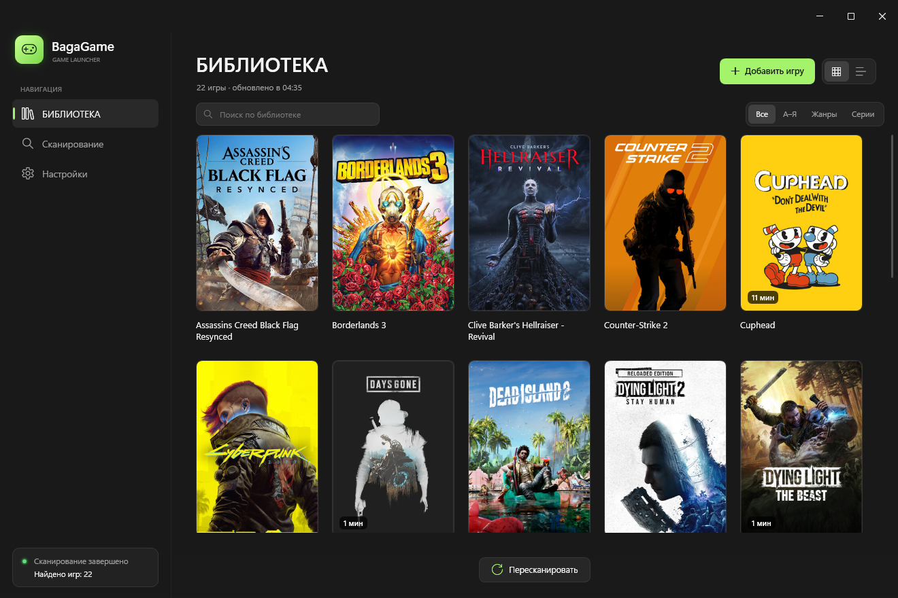
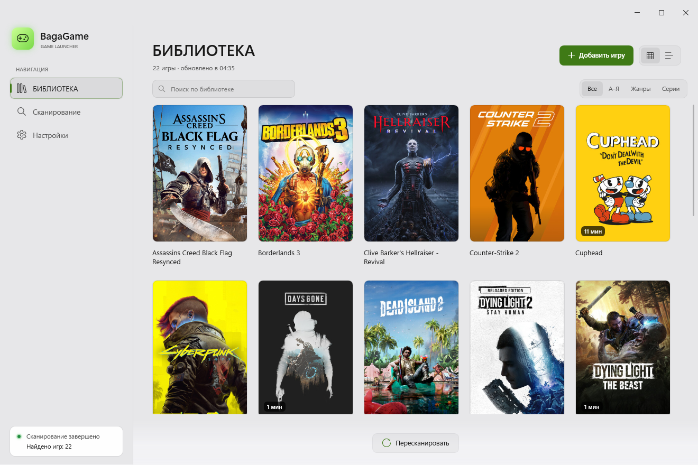
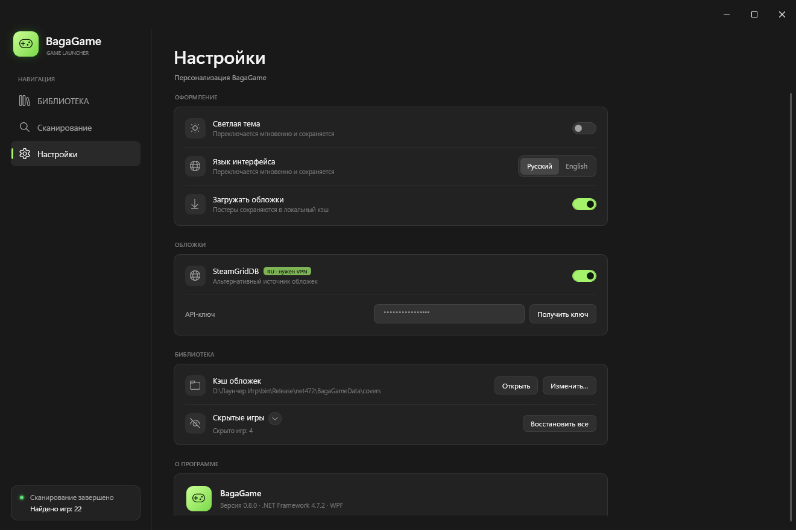
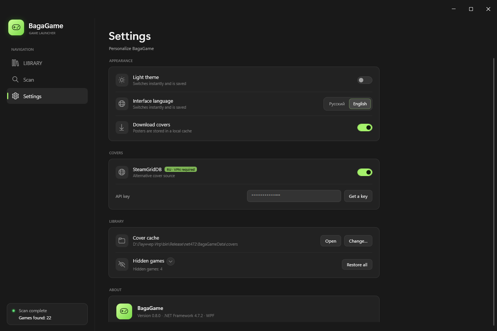
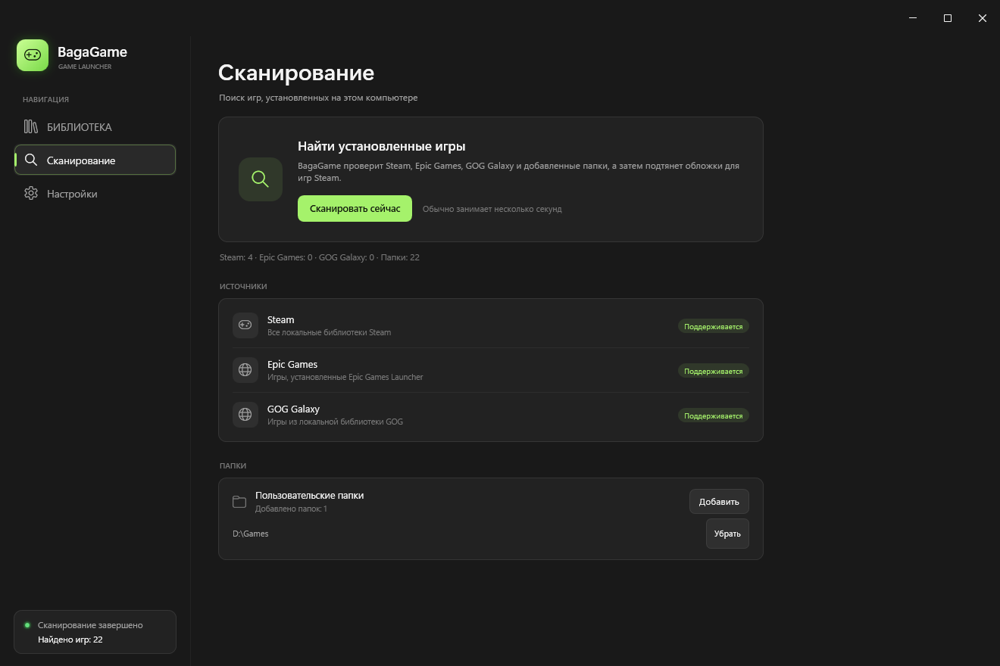
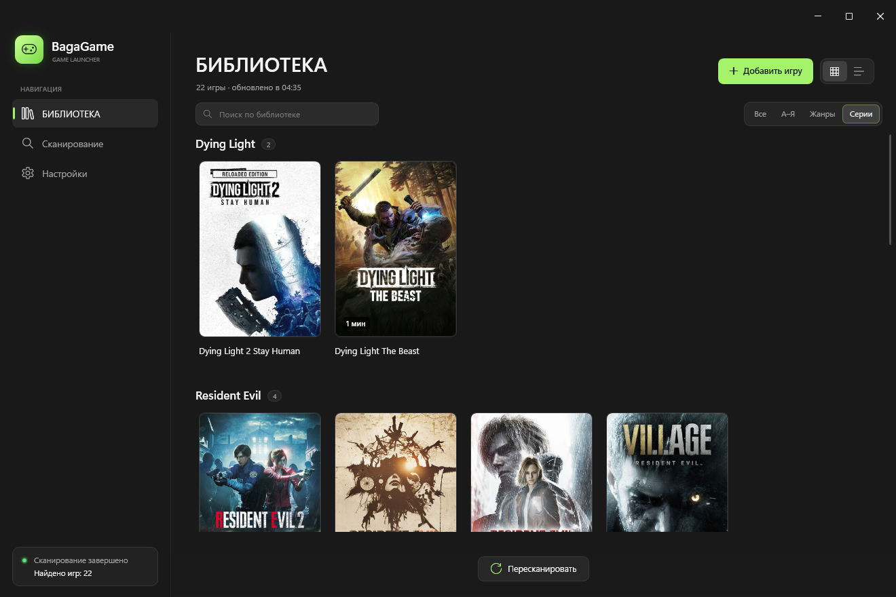
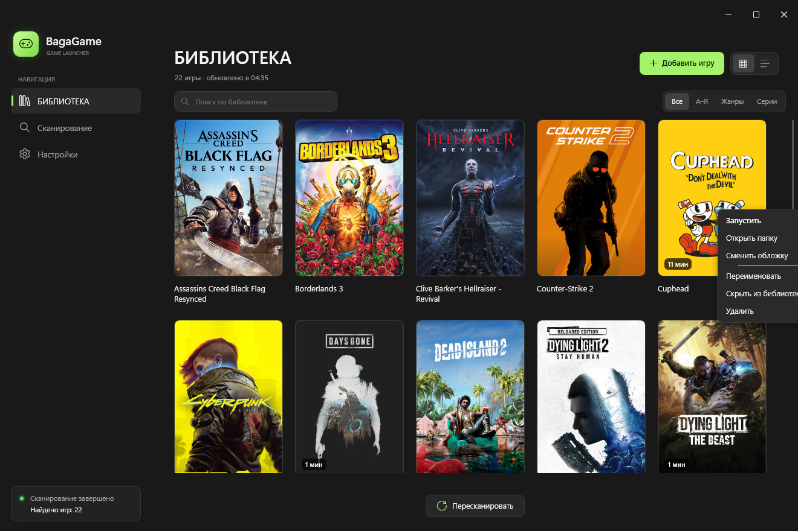
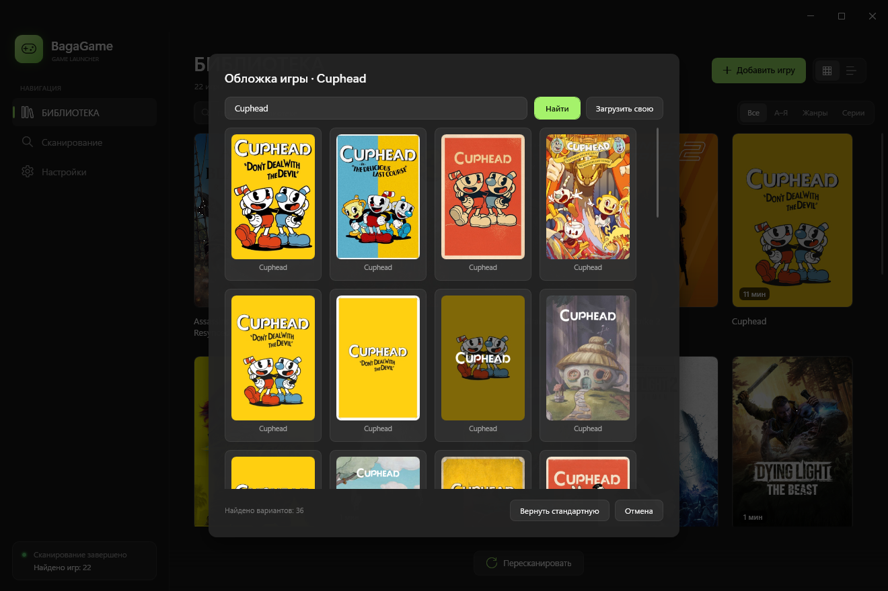
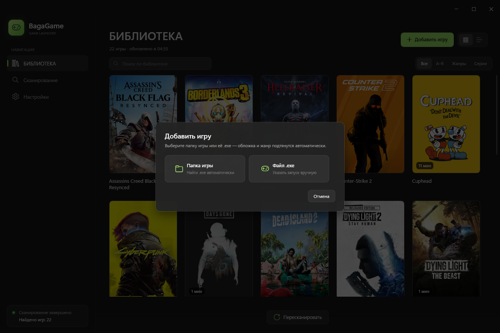
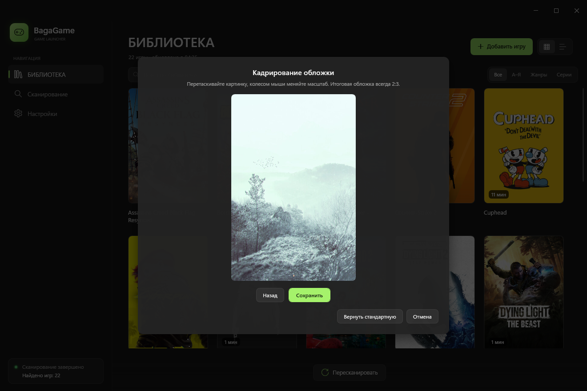

# 🎮 BagaGame Launcher

**Русский** · [English](README.md)

**BagaGame Launcher** — лёгкий и быстрый органайзер игровой библиотеки в стиле Windows 11 Fluent. Он собирает установленные игры в одну аккуратную коллекцию с постерами, группировкой по сериям и жанрам, поиском и учётом наигранного времени — вместо десятков ярлыков на рабочем столе.

Приложение написано на **C# / WPF** под **.NET Framework 4.7.2** и не использует сторонних UI-фреймворков: все контролы стилизованы вручную. Эта версия .NET уже входит в Windows 10 и 11, поэтому ставить рантайм не нужно, а весь лаунчер занимает около **2 МБ**.

---

## 📥 Установка

1. Откройте раздел **[Releases](https://github.com/bagabeer/BagaGame-Launcher/releases)** и скачайте архив последней версии (`v0.8.0`).
2. Распакуйте архив в любую папку, доступную для записи (например, `D:\BagaGame`).
3. Запустите **`BagaGame.exe`**.

Установщика нет — приложение работает сразу после распаковки. Все данные (библиотека, обложки, настройки) хранятся в папке `BagaGameData` рядом с `.exe`; если папка только для чтения (например, `Program Files`), они автоматически переносятся в `%LOCALAPPDATA%\BagaGame`.

> **Требования:** Windows 10 версии 1803+ или Windows 11. .NET Framework 4.7.2 уже включён в систему — ничего доустанавливать не нужно.
>
> Если Windows SmartScreen предупреждает о неизвестном издателе, нажмите **«Подробнее» → «Выполнить всё равно»**: файл не подписан сертификатом.

---

## 📸 Скриншоты

| Тёмная тема | Светлая тема |
|---|---|
|  |  |

| Настройки (RU) | Настройки (EN) |
|---|---|
|  |  |

| Сканирование | Группировка по сериям |
|---|---|
|  |  |

| Контекстное меню | Выбор обложки |
|---|---|
|  |  |

| Добавление игры | Кадрирование обложки |
|---|---|
|  |  |

---

## ✨ Возможности

* **Глубокое сканирование.** Находит игры в выбранных папках, включая нестандартные структуры и вложенные каталоги, отсеивая служебные `.exe` (`unins`, `vcredist`, `crashhandler` и подобные).
* **Интеграция с магазинами.** Импортирует библиотеки **Steam**, **Epic Games** и **GOG Galaxy**.
* **Обложки и жанры.** Подтягивает постеры и жанры из интернета, кэширует их локально и умеет работать без сети.
* **Группировка.** Режимы «Все», «А–Я», «Жанры» и «Серии»: франшизы (*Resident Evil*, *Dying Light*, *Silent Hill*…) собираются автоматически.
* **Учёт времени.** Считает наигранные часы для игр, запущенных через лаунчер, и показывает их прямо на карточке.
* **Сворачивание в трей.** При запуске игры окно уходит в системный трей, а после её закрытия **автоматически возвращается** на экран.
* **Русский и английский интерфейс.** Переключается в настройках без перезапуска и запоминается.
* **Тёмная и светлая темы.** На Windows 11 используется нативный эффект Mica; на Windows 10 — аккуратный непрозрачный фон.
* **Сетка и список.** Два режима отображения библиотеки, быстрый поиск (`Ctrl+F`) и пересканирование (`F5`).
* **Ручное добавление.** Можно добавить отдельную папку игры или конкретный `.exe`, а также переименовать, скрыть или удалить игру через контекстное меню.
* **Своя обложка.** Правый клик по карточке позволяет загрузить свою картинку и кадрировать её в рамке 2:3 с перетаскиванием и масштабом. Любая обложка сохраняется как постер 600×900; при включённом SteamGridDB можно также выбрать обложку сообщества.
* **SteamGridDB.** Дополнительный источник обложек по бесплатному API-ключу; включается в настройках и заменяет встроенный поиск Steam на обложки сообщества.
* **Один экземпляр.** Повторный запуск не открывает второе окно, а разворачивает уже работающее.
* **Надёжное сохранение.** Библиотека пишется атомарно (с резервной копией), а при недоступном диске карточка игры остаётся на месте с пометкой «Путь недоступен» и кнопкой «Указать папку заново».

---

## 🗂 Данные приложения

```text
<папка с BagaGame.exe>\BagaGameData\library.json   — библиотека, настройки, время, скрытые игры
<папка с BagaGame.exe>\BagaGameData\covers\        — кэш обложек (<AppID>.jpg) и storeids.json
<папка с BagaGame.exe>\BagaGameData\covers-custom\ — обложки, выбранные пользователем (600×900)
```

Если папка рядом с `.exe` недоступна для записи, используется `%LOCALAPPDATA%\BagaGame`.

| Ключ `library.json` | Назначение |
|---|---|
| `Hidden` | Скрытые игры |
| `CustomTitles` | Пользовательские названия |
| `Folders` | Папки для сканирования |
| `ManualGames` | Игры, добавленные вручную |
| `Genres` | Кэш жанров (хранятся канонические английские названия) |
| `Playtime` | Наигранное время в секундах |
| `CustomCovers` | Пользовательские обложки в `covers-custom` |
| `UseSteamGridDb`, `SteamGridDbApiKey` | Источник SteamGridDB и API-ключ |
| `Theme`, `Language`, `GridView`, `Grouping`, `DownloadCovers`, `CacheDirectory` | Настройки интерфейса |

---

## 🛠 Сборка из исходников

Нужен только **.NET SDK 8+**: он собирает проект под .NET Framework 4.7.2 через reference assemblies, Visual Studio не обязательна.

```powershell
dotnet build BagaGame.csproj -c Release
dotnet run --project BagaGame.csproj
```

Готовый `.exe` появится в `bin\Release\net472\`. Отдельный установщик и portable-публикация не требуются: достаточно скопировать папку сборки.

### Структура проекта

```text
BagaGame.csproj                     — net472, WPF + WinForms (только трей), без сторонних UI-пакетов
App.xaml / App.xaml.cs              — запуск, единственный экземпляр, язык, тема
MainWindow.xaml / .xaml.cs          — окно, карточки, поиск, горячие клавиши, трей
ViewModels/MainViewModel.cs         — фильтрация, группы, статусы, обложки
Models/Game.cs                      — модель игры и локализованные подписи
Services/GameLibraryService.cs      — сканер Steam / Epic / GOG / папок, обложки и жанры
Services/PlaytimeTracker.cs         — учёт времени и событие завершения игры
Services/LibraryStore.cs            — атомарное сохранение library.json
Services/LibraryGrouping.cs         — группы «А–Я», «Жанры», «Серии»
Services/Localization.cs            — RU/EN и словари строк
Services/TrayIcon.cs                — иконка и меню в трее
Services/AppPaths.cs                — портативная папка данных
Themes/                             — палитры, стили контролов, Strings.ru/en.xaml
Controls/                           — собственные Fluent-контролы (окно, кнопки, переключатели)
Compat/                             — полифиллы для современного C# на net472
```

---

## 📝 Changelog

### Версия 0.8.0 (текущая) — обновление обложек

**Выбор обложки**
* Правый клик по карточке → **«Сменить обложку»**.
* До 36 обложек сообщества из SteamGridDB для выбранной игры.
* Можно загрузить свою картинку: JPG, PNG или BMP до 12 МБ.
* Картинку можно двигать мышью и масштабировать колесом в рамке 2:3.
* Любая обложка сохраняется как постер 600×900, поэтому карточки не разъезжаются.
* **«Вернуть стандартную»** убирает свою обложку и возвращает автоматическую.
* Выбор сохраняется после перезапуска.

**SteamGridDB**
* Новый раздел в настройках: включение, поле API-ключа и кнопка **«Получить ключ»**.
* Показываются обложки только найденной игры, без чужих игр.
* Зелёная плашка **«RU · нужен VPN»** напоминает, что в России SteamGridDB может требовать VPN.

**Библиотека и карточки**
* У игры без постера в правом верхнем углу появляется подсказка **«Добавить обложку»**; фон проявляется при наведении.
* Скрытые игры можно восстанавливать по одной, список раскрывается маленькой стрелкой.
* У скрытых игр показывается папка или магазин, как в основном списке.
* Окно выбора обложки стало компактным: четыре обложки в ряд, без пустоты справа.
* На экране кадрирования один понятный заголовок и настоящая рамка 2:3.
* Убраны лишние подписи и зелёное выделение текста при открытии окна.

**Внешний вид**
* Новая иконка приложения — зелёный геймпад.
* Убраны светящаяся рамка окна и лишняя обводка диалогов.
* Мелкие правки отступов, размеров кнопок и текста.

**Исправления**
* SteamGridDB больше не подмешивает обложки других игр.
* Обложки корректно сохраняются и остаются после перезапуска.
* Кадрирование больше не обрезается и всегда сохраняет пропорции 2:3.

### Версия 0.7.0

**Размер и платформа**
* Переход с .NET 8 на **.NET Framework 4.7.2** — он уже есть в Windows 10 1803+ и Windows 11, поэтому лаунчер запускается без установки рантайма.
* Удалён **WPF-UI**: кнопки, переключатели, заголовок окна, скроллбары, меню и подсказки теперь собственные. Сторонних UI-пакетов нет.
* Размер сборки уменьшился с **13,5 МБ до ~2 МБ**.
* Из репозитория удалены PowerShell-скрипты и всё, что требовалось для сборки помимо .NET SDK.

**Исправления (issue #1)**
* Атомарное сохранение `library.json` с резервной копией `.bak` — сбой записи больше не обнуляет библиотеку.
* Безопасная обработка путей: запрет выхода за пределы выбранной папки, проверка доступности диска.
* Ограничения на обложки: размер файла, разрешение, количество пикселей и список разрешённых хостов.
* Точное сопоставление процессов игры — трекер больше не считает время чужому процессу с похожим именем.
* Корректная отмена сканирования и защита от повторного запуска.
* Стабильные идентификаторы источников (`Folder` / `Manual`) и миграция старых жанров.
* Ручные игры не пропадают, если их папка временно недоступна.
* Удалённая игра больше не возвращается после пересканирования: она автоматически попадает в скрытые.
* Дубликаты, найденные через разные `.exe` одной папки, схлопываются в одну карточку.
* Для загрузки обложек и жанров принудительно используется TLS 1.2.

**Новое**
* Автоматическое возвращение окна из трея после закрытия запущенной игры.
* Переключение **RU / EN** без перезапуска с сохранением выбора.
* Портативные данные в `BagaGameData` рядом с `.exe` с запасным вариантом в `%LOCALAPPDATA%`.
* Защита от второго экземпляра: повторный запуск поднимает существующее окно.
* Пометка «Путь недоступен» на карточке и пункт «Указать папку заново».
* Скрытые игры можно восстанавливать по одной прямо в настройках, а не только все сразу.
* Асинхронное ручное добавление игр — интерфейс не подвисает на больших папках.
* Выбор обложки: загрузка своей картинки и кадрирование 2:3 с перетаскиванием и масштабом; старый веб-поиск Steam убран.
* SteamGridDB: поле API-ключа в настройках, до 36 обложек сообщества и результаты строго для найденной игры.
* Обновлённые строки интерфейса, счётчики найденных и показанных игр.

### Версия 0.6.0
* Встроенный счётчик наигранного времени.
* Улучшенный глубокий поиск `.exe` в скрытых и нестандартных папках.
* Сворачивание в системный трей при запуске игры.
* Пункт «Удалить из библиотеки» в контекстном меню.
* Автоматическое сканирование при старте.

### Версия 0.5.3
* Первый публичный релиз.
* Импорт из Steam и Epic Games.
* Группировка по сериям.
* Ручное добавление игр и папок.

---

## ⚠️ Известные ограничения

* **Жанры.** Определяются через Steam Store API; неизвестные игры попадают в группу «Другое».
* **Пользовательские папки.** Поиск основан на `.exe`, поэтому служебные утилиты иногда попадают в библиотеку — их можно скрыть или удалить через контекстное меню.
* **Mica.** Эффект доступен только на Windows 11 (build 22000+). На Windows 10 используется обычный фон темы.
* **Античиты и лаунчеры.** Если игра запускается через сторонний лаунчер (Ubisoft Connect, Rockstar Launcher и т. п.), трекер может не увидеть процесс и не засчитать время.

---

## 🐛 Обратная связь

Нашли баг или хотите предложить улучшение? Откройте **[Issue](https://github.com/bagabeer/BagaGame-Launcher/issues)** с описанием шагов для воспроизведения — это очень помогает.

---

## 📄 Лицензия

Проект распространяется по лицензии **MIT**. Подробности — в файле [LICENSE](LICENSE).

Сделано с ❤️ для геймеров.
